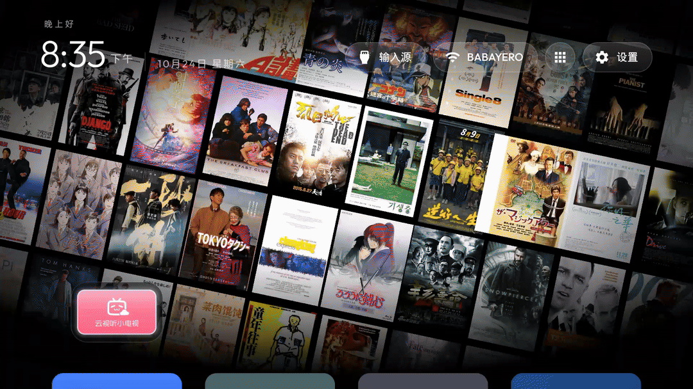

# Every Picture Tells a Story

**把你看过（或想看）的电影海报，变成电视上的一面会呼吸的电影海报墙。**

斜向棋盘式铺展的海报墙，按海报主色自动分成"色调池"，每隔几秒整面墙以不同的编排
（波纹递进 / 列扫 / 棋盘交替 / 螺旋 / 风暴齐翻……12 种）翻成另一种色调；中心聚焦、
四周暗角与模糊，像电影片头一样。



> 项目名来自 Rod Stewart 1971 年的同名专辑——Every Picture Tells a Story，
> 每一张海报，都在讲你自己的故事。

## 它是什么

一个跑在 [cleanyourtv](https://github.com/) 启动器上的"电影海报墙"主题，外加一套
把你的观影清单变成海报数据的工具链：

```
观影清单 ──► Chrome 插件（用你的豆瓣登录态逐个抓海报）──► 合并 + 颜色分析
                                                              │
电视 ◄── 一键推送（主题 config + 海报包）◄── manifest.json ◄──┘
```

- **暗角与聚焦**：Canvas 逐像素生成的暗角贴图 + 边缘模糊，中心清晰、四周渐入纯黑；
- **色调巡演**：每张海报自动做主色分析归入色调池（黑白/橙/蓝/红/青/金），整面墙
  定期"翻"成另一种色调；
- **12 种翻转编排**：波纹递进、列扫、行扫、对角线、棋盘交替、螺旋、随机逐格、
  风暴齐翻、向心收拢、翻牌时刻……全部可以在电视上用遥控器实时切换。

## 快速开始

### 路线 A：让 AI 助手帮你（推荐，零基础也能走通）

1. 克隆/下载本仓库到与电视同一 Wi-Fi 的电脑；
2. 电视端照 [PROMPT.md](PROMPT.md) 开头的一次性步骤开启开发者选项和 ADB 调试；
3. 打开你的编程助手（Claude Code / Codex / ZCode / Gemini CLI…），把
   [PROMPT.md](PROMPT.md) 里的提示词整段粘贴发送。

助手会按 [AGENTS.md](AGENTS.md) 的固定流程执行：缺 Python/adb 就帮你装、
检测电视适配度、**先备份再动手**、引导你选影单来源、装插件抓海报、
推送电视并逐步截图验证。

### 路线 B：手动执行

> 详细步骤和每一步的注意事项见 [docs/](docs/)，这里是最短路径。
> 所有命令在仓库根目录执行；Windows 控制台建议先 `chcp 65001`。

```bash
# 0) 环境检测（会告诉你缺什么、怎么装）
python tools/env_check.py

# 1) 连上电视并备份（安全第一步：默认桌面/应用列表/设置全部存档）
adb connect 电视IP:5555
python tools/tv_check.py        # 电视适配度检测
python tools/backup_tv.py       # 一键备份

# 2) 安装带海报墙支持的 cleanyourtv 启动器（三选一，见 docs/TV-COMPAT.md）

# 3) 准备影单（三选一，见下"你需要做的决定"）
python tools/parse_list.py 你的观影清单.md

# 4) Chrome 装上插件，抓海报（见 extension/README.md）
#    或者：什么都不做，直接用仓库自带的默认海报包

# 5) 合并、分析颜色、推上电视
python tools/merge_extension_results.py
python tools/build_manifest.py
python tools/push_theme.py --theme themes/example-kd55x9100h
```

### HTML 预览（不需要电视，调参数用）

```bash
# 在仓库根目录执行（preview 页面从根目录取数据）
python -m http.server 8765
# 浏览器打开 http://127.0.0.1:8765/preview/
```

## 你需要做的决定

| 决定 | 选项 | 说明 |
|---|---|---|
| 海报从哪来 | ① 抓豆瓣"我的影单" ② 导入清单文件 ③ 不抓，用默认海报包 | ①② 需要浏览器登录豆瓣；③ 开箱即用 |
| 清单格式 | [docs/MOVIE-LIST.md](docs/MOVIE-LIST.md) | 一行一部即可，笔记式格式也支持 |
| Dock 风格 | 单应用（默认）或标准四格 | 主题 config 里 `dock_apps` / `dock_scale_percent` |
| 画面效果 | 暗角/模糊/范围，电视上直接调 | 电视设置 → 简洁桌面设置 → 海报墙 |

## 安全承诺：为什么不用担心搞坏电视

本项目对电视只做三件事，**每一件都可逆**：

1. 安装/更新一个普通应用（cleanyourtv 启动器，非系统应用，卸载即净）；
2. 往该应用自己的外部存储目录写主题和海报文件（卸载自动删除）；
3. 把默认桌面设置项指向该启动器（一条命令改回）。

不碰系统分区、不需要 root、不需要解锁 bootloader。**开始前先跑
`python tools/backup_tv.py`**——默认桌面、应用列表、无障碍设置、改动前截图
全部存档，恢复命令会生成在 `backups/<时间戳>/REPORT.md` 里，逐条可执行。
详见 [docs/SAFETY.md](docs/SAFETY.md)。

## 隐私承诺

- 本仓库**没有任何服务器**：没有后端、没有统计、没有上报；
- Chrome 插件完全在本地运行，唯一需要的"登录豆瓣"只用于**读取你本人能看到的页面**
  （影单页、条目页），因为豆瓣对未登录/脚本请求有严格限流，用你的登录态 +
  人速请求是唯一稳定的方式；
- 所有代码开放可查：插件一共 4 个文件（[extension/](extension/)），数据只落在
  你自己的下载目录和本仓库目录；
- 不登录豆瓣也完全可用：仓库自带 320+ 张默认海报包。

详见 [docs/PRIVACY.md](docs/PRIVACY.md)。

## 电视适配度

| 项目 | 要求 | 说明 |
|---|---|---|
| Android | ≥ 8.0（API 26） | cleanyourtv launcher 的 minSdk |
| 架构 | armeabi-v7a / arm64 | 主流电视都覆盖 |
| 分辨率 | 1080p / 4K | 自动适配；4K 上面板参数可调 |
| 已知限制 | Android 10 无实时系统级模糊 | 用定期快照近似，见 docs/TV-COMPAT.md |

更多适配细节与已测设备：[docs/TV-COMPAT.md](docs/TV-COMPAT.md)。

## 目录结构

```
├── extension/      Chrome 插件（豆瓣海报抓取，本地运行）
├── tools/          全部工具脚本（检测/备份/解析/合并/推送）
├── themes/         主题示例（config + 海报推送配置）
├── posters/        默认海报包（320+ 张，随仓库分发）
├── data/           清单数据与颜色分析结果
├── preview/        HTML 预览（无电视也能看效果、调参数）
├── patches/        给 cleanyourtv 启动器的海报墙补丁
├── docs/           安全 / 隐私 / 清单格式 / 电视适配
└── shots/          截图与演示动图
```

## 致谢

- [cleanyourtv](https://github.com/) —— 海报墙所依附的启动器，MIT 协议；
- [scrcpy](https://github.com/Genymobile/scrcpy) —— 流畅录屏；
- [豆瓣](https://movie.douban.com/) —— 海报与评分数据来源（版权归原方，仅供个人欣赏）；
- Rod Stewart —— *Every Picture Tells a Story*, 1971。

## License

[MIT](LICENSE)
